# University Explorer Portal


### Overview
A Blazor Web Application that helps prospective students explore universities around the world and manage their university applications. The University Explorer page is an **API mashup**: it combines country data from the Countries API with university data from the Universities API on a single page. Student applications are viewed, created, edited and deleted through the Edutots Student Application API.

### 🚀 Features

**Core requirements**

✅ API mashup: country details and the universities of the selected country on one page  
✅ Country dropdown with all countries, changeable at any time  
✅ Country details card: name, capital, region, population and flag  
✅ Universities list with live search by name  
✅ University details: name, country, website and domain  
✅ View student applications (GET)  
✅ Create a student application with `EditForm` and validation (POST)  
✅ Edit an existing application and return to the list (PUT)  
✅ Validation with Data Annotations and messages under each field  
✅ Loading indicators for countries, universities and applications  
✅ Error handling with a "Try again" button  
✅ Reusable components with `[Parameter]` and `EventCallback`  
✅ Navigation menu linking all areas of the application

**Distinction features**

✅ Delete application with a confirmation dialog  
✅ Sorting universities (A to Z and Z to A)  
✅ Favourite universities, with a favourites filter and a Favourites page  
✅ Statistics on the home page:
- Universities worldwide
- Countries with universities
- Country with the most universities

✅ Local Storage persistence: favourites, explorer settings (selected country, sort order, favourites filter) and the colour theme  
✅ Pagination for universities and applications  
✅ Dark mode with a theme toggle  
✅ Responsive Bootstrap design  
✅ bUnit and xUnit tests, run automatically on every push with GitHub Actions

**Extras**

✅ "Apply to this university" button in the university details, which opens the Create form with the country and university filled in  
✅ Country and university suggestions in the application form, loaded from the Countries and Universities APIs  
✅ Original logo and a custom burgundy design system

### 🌐 APIs

The app uses three APIs:

| API | Base URL | Used for |
|---|---|---|
| Countries API | `https://countries.dev/countries` | Country list and country details |
| Universities API | `http://universities.hipolabs.com/search` | Universities of the selected country and the home page statistics |
| Student Application API | `https://edutots.net/api/studentapplication` | Viewing, creating, editing and deleting applications |

Base addresses are stored in `appsettings.json` rather than hard-coded.

**Country names in the mashup.** The two country-related APIs use different names for some countries (for example "United States of America" vs "United States", or "Turkey" vs "Turkiye"). Without a fix, these countries would show no universities. The differences were found by matching both APIs on ISO alpha-2 country codes with a small script, and the 17 mismatches are stored in a dictionary in `UniversityService`. Universities exist for 201 of the 250 countries; for the rest, the page shows a "No universities found" message.

### 🧩 Pages

| Page | Route |
|---|---|
| Home | `/` |
| University Explorer | `/university-explorer` |
| Favourite Universities | `/favourites` |
| Student Applications | `/student-applications` |
| Create Student Application | `/student-applications/create` |
| Edit Application | `/student-applications/edit/{id}` |

### 🏗 Design Decisions

- **Services behind interfaces.** Every service that calls an API or the browser has an interface (`ICountryService`, `IUniversityService`, ...). Pages depend on the interfaces, which makes it possible to replace the services with fakes in tests.
- **Typed `HttpClient`.** Each API service gets its own `HttpClient` registered with `AddHttpClient<TInterface, TImplementation>` and a **30-second timeout**, so that a hanging API shows an error instead of waiting for the default 100 seconds.
- **Error handling.** Services let exceptions through, and pages catch them and show the error state. This keeps data access and UI separate. `GetByIdAsync` is the only exception: it returns `null` for 404, so the Edit page can show "Application not found".
- **Stale responses are ignored.** If the user switches country while universities are still loading, the older response is discarded, so the list always matches the selected country.
- **Server-side caching.** The full universities dataset (about 10,000 records) used for the statistics is cached in memory for one hour with `IMemoryCache`.
- **Render mode.** `@rendermode InteractiveServer` is set on pages only. Reusable components inherit it, so `EventCallback` parameters work correctly.
- **Local storage.** A `LocalStorageService` wraps the browser's `localStorage` and is used by the favourites and the explorer settings. The colour theme is the only exception: it is applied by a small script (`wwwroot/js/theme.js`) before the page is drawn, to avoid a flash of the wrong theme.
- **Design system.** Colours, shadows and sizes are defined once as CSS variables in `app.css`, for both the light and the dark theme.

### 🧪 Tests

The `UniversityExplorer.Tests` project (xUnit and bUnit) contains 30 tests:
- **Models:** statistics calculation and validation rules of `StudentApplication`
- **Services:** country name mapping, removal of duplicates, caching and favourites persistence
- **Components:** `Pagination`, `CountrySelector`, `StudentApplicationForm`, `StatisticsOverview` and `ErrorAlert`

The tests never call the real APIs: services are replaced with fakes and a fake `HttpMessageHandler`. A GitHub Actions workflow (`.github/workflows/tests.yml`) runs all tests on every push.

### 📂 Project Structure

UniversityExplorer/  
│  
├── Models/  
│   ├── Country.cs, CountryFlags.cs # Countries API  
│   ├── University.cs # Universities API  
│   ├── StudentApplication.cs # Student Application API, with validation attributes  
│   ├── UniversityStatistics.cs # Statistics for the home page  
│   └── ExplorerPreferences.cs # Settings saved in local storage  
│  
├── Services/  
│   ├── CountryService.cs  
│   ├── UniversityService.cs # Country name mapping and caching  
│   ├── StudentApplicationService.cs # GET, POST, PUT, DELETE  
│   ├── FavouritesService.cs  
│   └── LocalStorageService.cs # (each service has an interface)  
│  
├── Components/  
│   ├── Common/ # ConfirmDialog, EmptyState, ErrorAlert, LoadingIndicator, PageHeader, Pagination, StatCard  
│   ├── Universities/ # CountryDetails, CountrySelector, StatisticsOverview, UniversityCard, UniversityDetails  
│   ├── Applications/ # StudentApplicationForm, StudentApplicationList  
│   ├── Layout/ # Main layout and navigation menu  
│   └── Pages/ # Home, UniversityExplorerPage, Favourites, StudentApplications, CreateStudentApplication, EditStudentApplication  
│  
├── wwwroot/ # app.css, theme script, logo, favicon  
├── appsettings.json # API base addresses  
└── Program.cs # Service registration  

UniversityExplorer.Tests/ # xUnit and bUnit tests  
.github/workflows/tests.yml # Runs the tests on every push

The brief suggests a flat `Components` folder. As the number of components grew to fourteen, they were grouped by feature: shared UI building blocks in `Common`, and feature-specific components in `Universities` and `Applications`.

### 🛠 Technologies Used
- C# / .NET 10
- Blazor Web App (Interactive Server)
- HttpClient and System.Text.Json
- Bootstrap 5 and Bootstrap Icons
- Custom CSS with a light and a dark theme
- xUnit and bUnit
- GitHub Actions

### 🔧 Installation & Usage
The .NET 10 SDK and an internet connection are required.

Run the application:

```bash
git clone https://github.com/Oleg-Dergunov/UniversityExplorer.git
cd UniversityExplorer/UniversityExplorer
dotnet run
```

Then open the address shown in the console (for example `https://localhost:7133`).

Run the tests from the repository root:

```bash
dotnet test
```

### ⚠️ Known Limitations

- **Application Date is not stored by the API.** The field is required and validated in the form, and it is sent in POST and PUT requests, but the Student Application API does not return it. The Applications page shows "—" in the date column. On the Edit page the date is not editable, because the date of an application should not change after it is submitted.
- **The API rejects `null` for `personalStatement`**, so the model sends an empty string by default.
- **The Student Application API is shared** by the whole class, so the list contains applications created by other students.
- **Flag emojis are not shown on Windows**, so the flag image from the Countries API is used instead.

### 📸 Screenshots

**Home page**

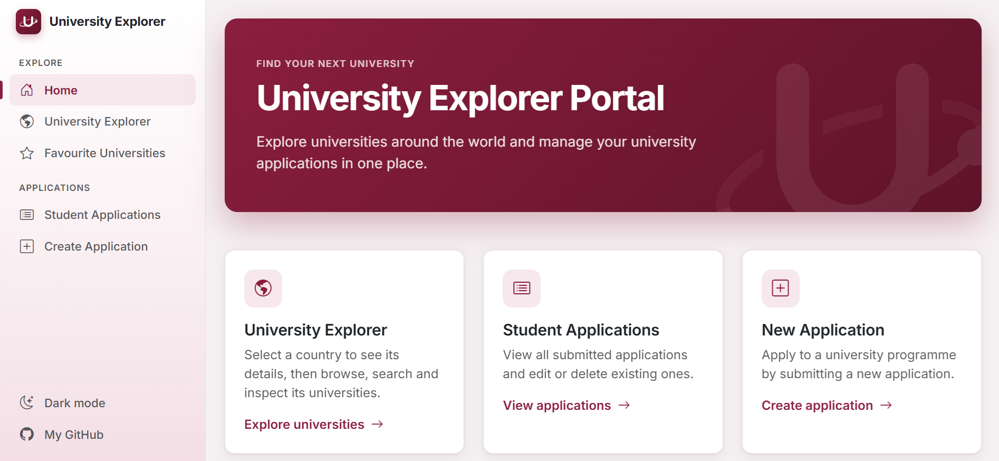

Statistics on the home page:

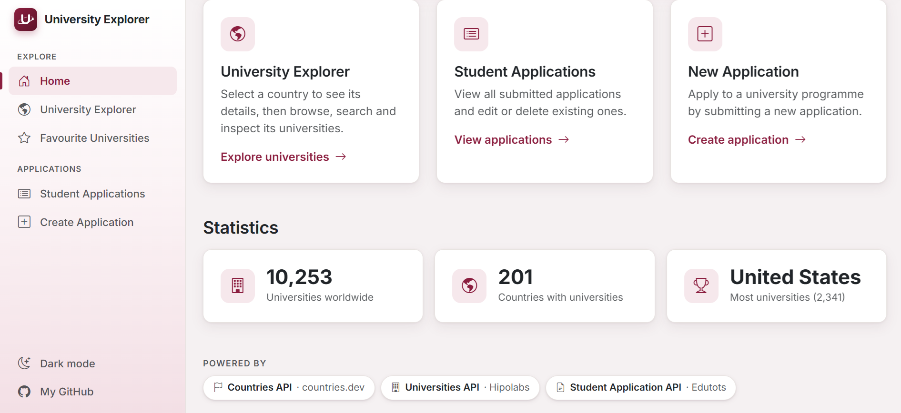

**University Explorer page**

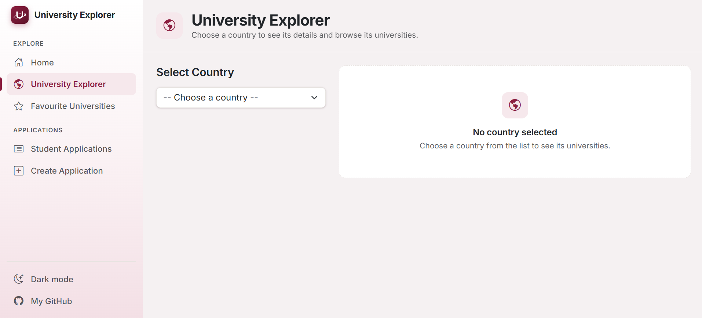

**Country selected, country details and universities loaded**

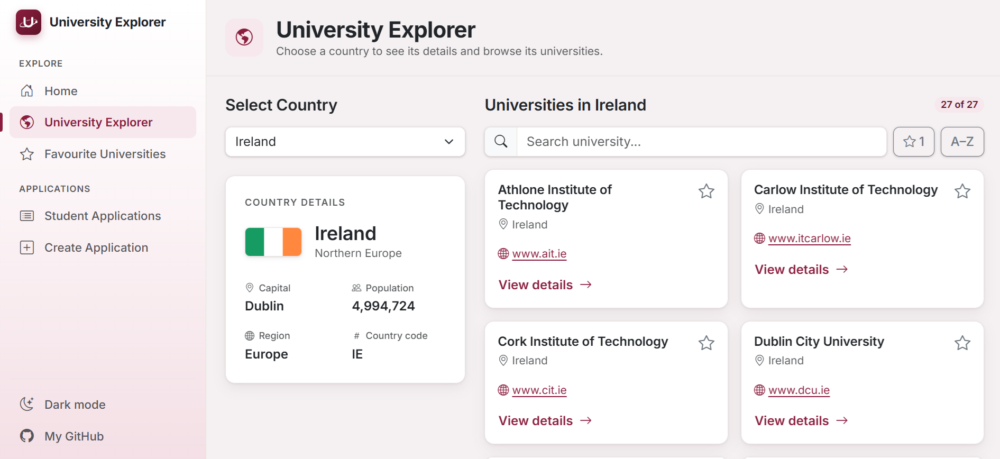

The country details card (left) and the universities of the selected country (right) are shown on the same page.

**University search**

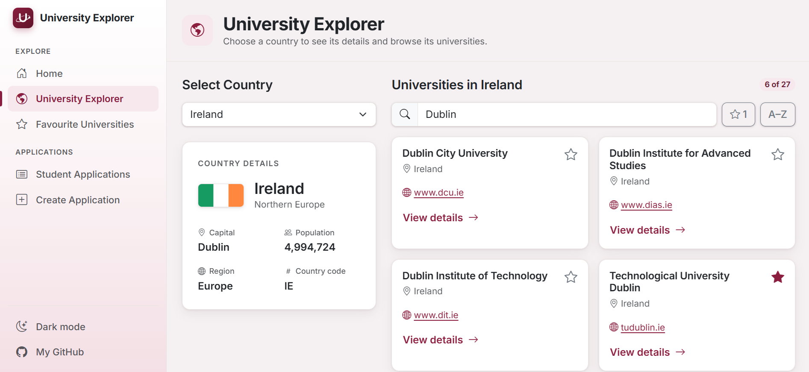

**University details**

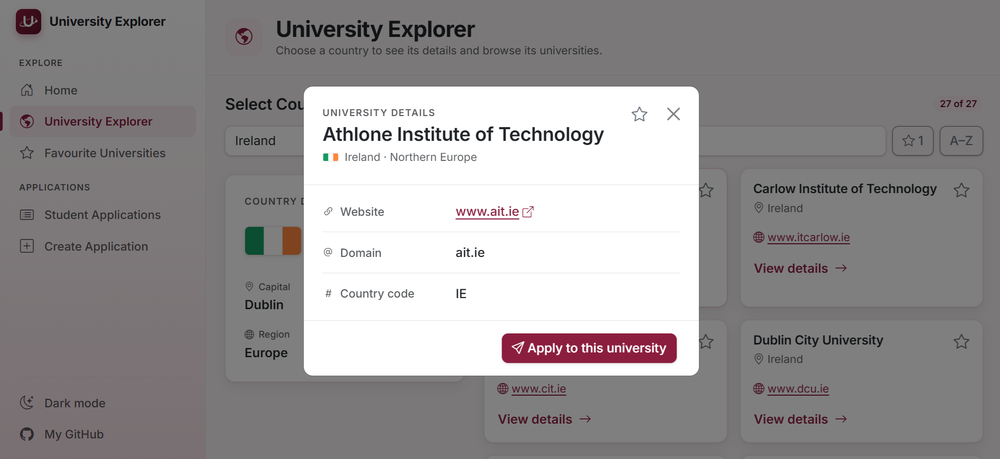

**Student Applications page (GET)**

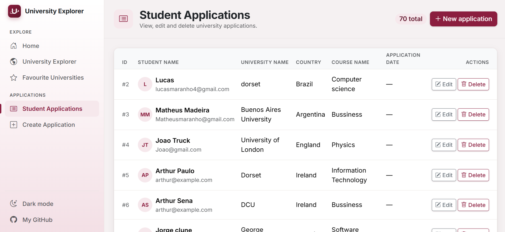

**Create Student Application page (POST)**

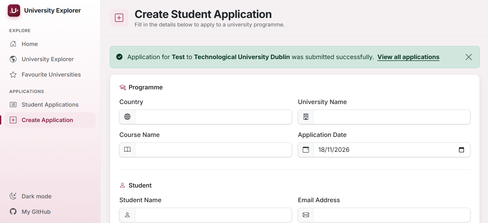

**Validation messages**

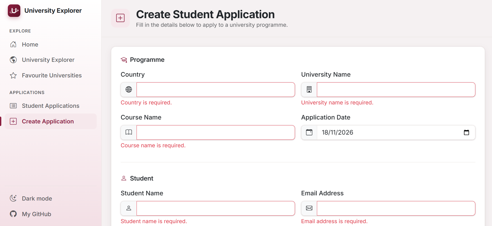

**Edit Application page (PUT)**

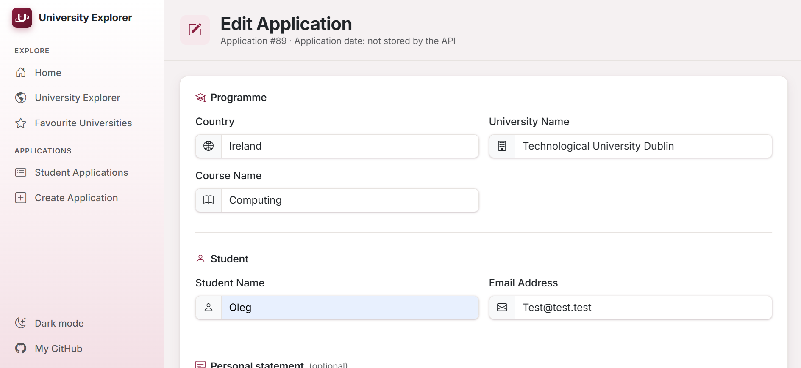

After saving, the app returns to the Applications page, shows a confirmation message and highlights the updated row:

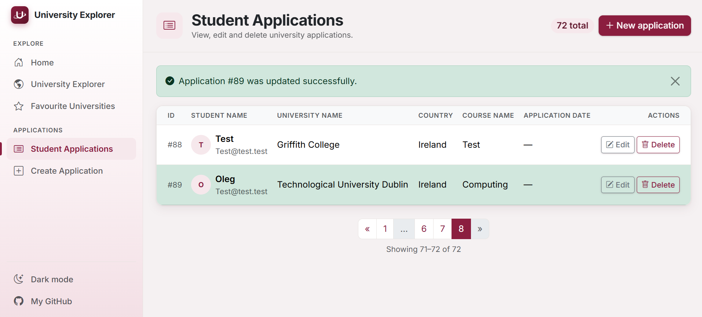

**Loading state**

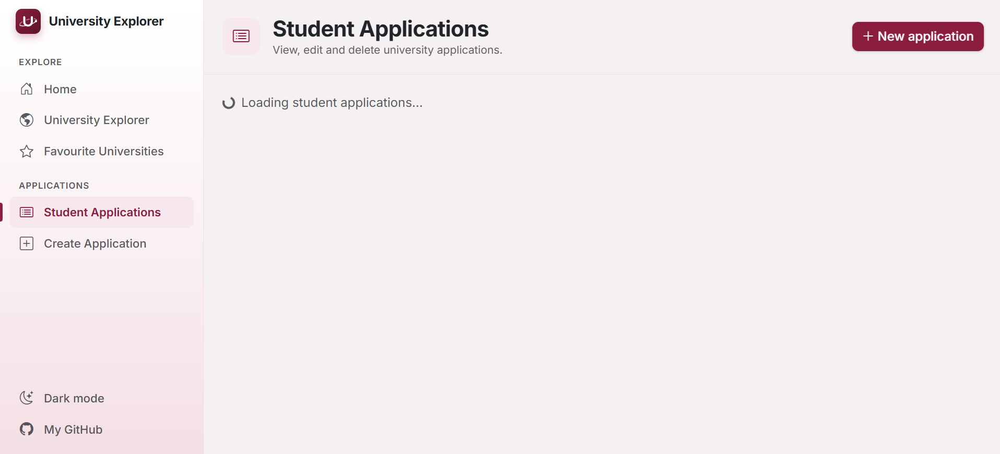

**Error state**

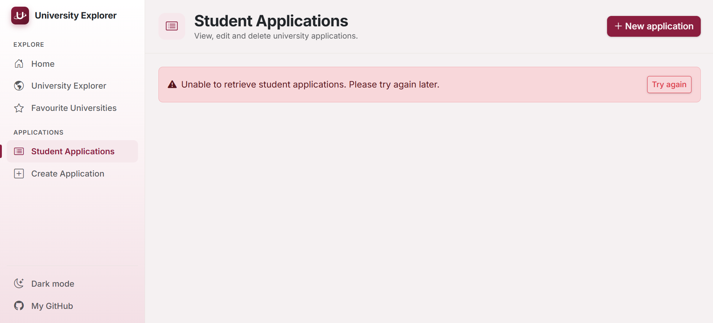

**Bonus features**

Delete with confirmation:

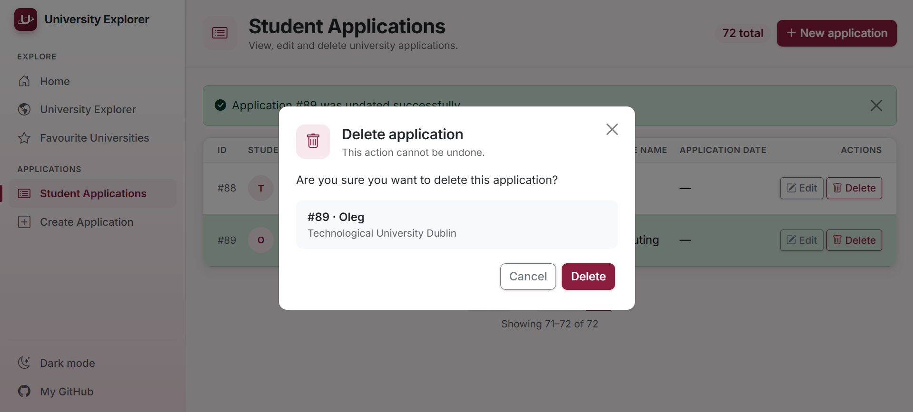

Favourites filter and the Favourites page:

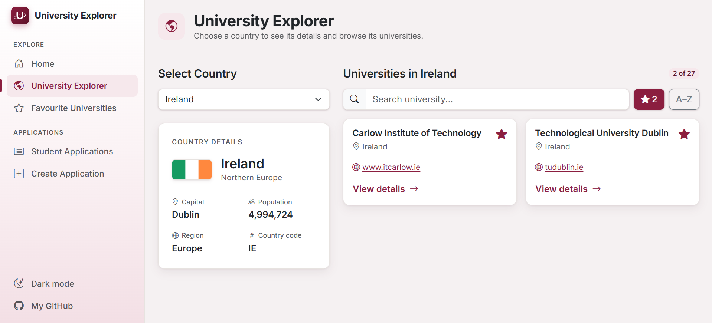

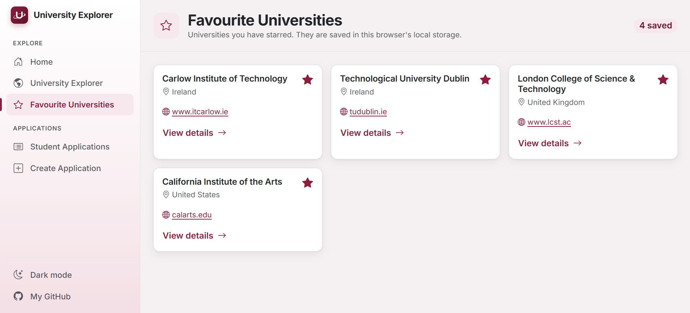

Favourites and settings saved in local storage:

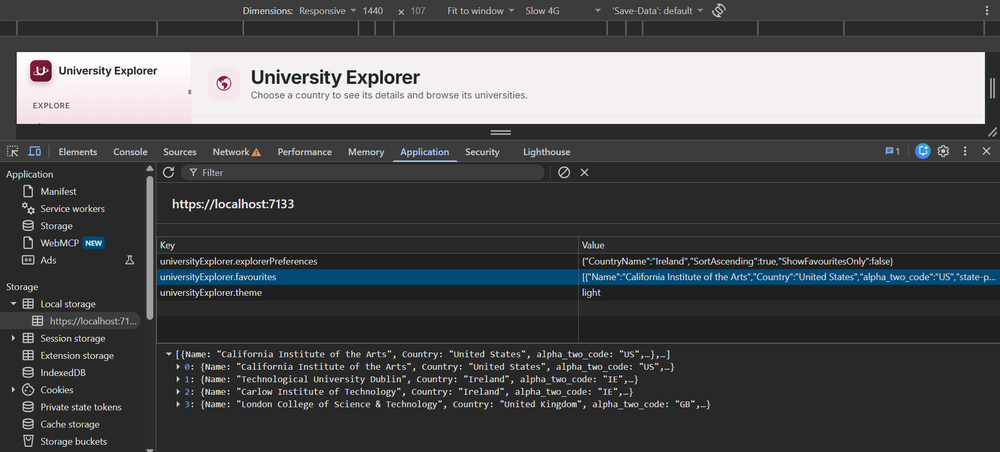

Sorting (Z to A):

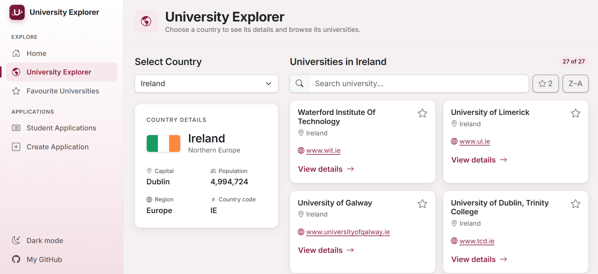

Pagination of universities and applications:

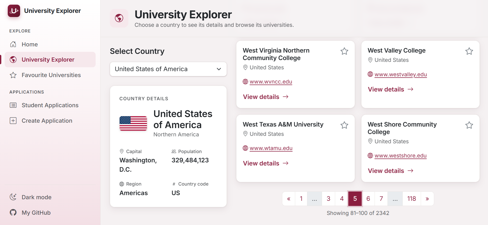

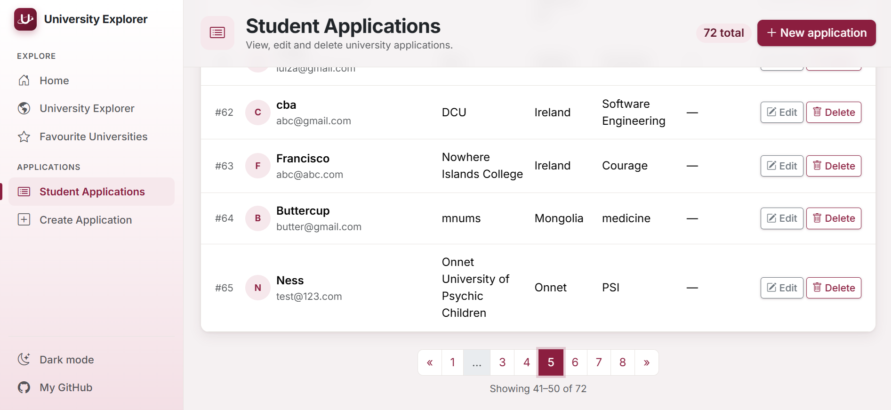

Dark mode:

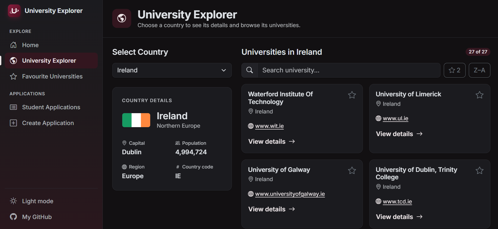

Responsive layout on a phone:

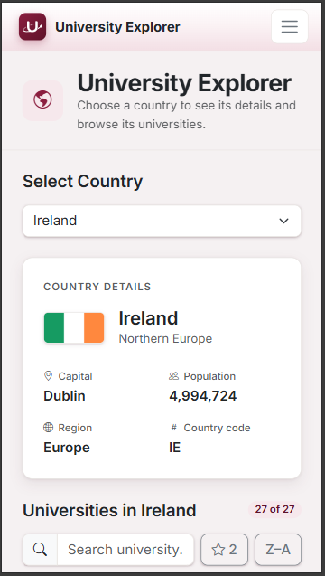

Tests passing in GitHub Actions:

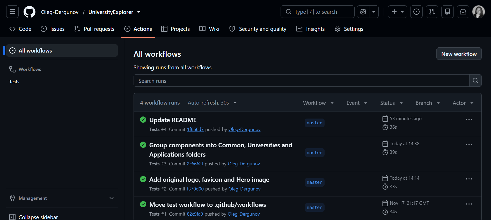
